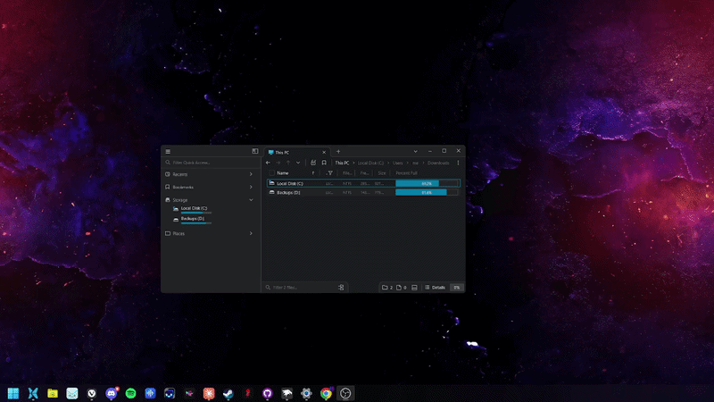

# Window Wobble

A [Windhawk](https://windhawk.net) mod that gives Windows KDE/Compiz-style
spring-physics window dragging. Grab a title bar and the window follows your
cursor like jelly — the title bar keeps up, the body trails behind, and it
settles with a wobble when you let go.



Hold **Shift** (configurable) while grabbing to move a window normally.

## Install

Install [Windhawk](https://windhawk.net/), then find **Window Wobble - by
HeyJeay** in the mod browser.

To build it yourself: Windhawk → **Create New Mod**, paste
[`window-wobble.wh.cpp`](window-wobble.wh.cpp), press **Compile**.

## How it works

### In plain terms

1. You press on a title bar, and the mod quietly takes a photograph of the
   whole window.
2. The real window is made invisible. Not minimised, not moved — just not
   drawn. Its taskbar button stays exactly where it was.
3. The photograph is pinned to an invisible grid, like a sheet of rubber, and
   shown in the window's place. The top edge of the sheet is stiff and keeps up
   with your cursor; further down it gets floppier. That is the whole trick —
   the body lags behind the title bar because the bottom of the sheet is softer
   than the top.
4. All the while you are dragging, the mod is just moving that rubber sheet
   around and letting the springs do what springs do.
5. When you let go, the real window is moved to where you dropped it while it is
   still invisible, then made visible again *underneath* the photograph. Only
   once it is safely back does the photograph disappear, so you never catch the
   swap happening.

Two things follow from this. The window content is a photograph for as long as
you hold it, so a playing video looks frozen. And because the mod is dragging
the window instead of Windows, Windows' own dragging features — Aero Snap, Snap
Layouts, shake to minimize — do not happen. Holding **Shift** gives you an
ordinary Windows drag, with all of that back.

### Under the hood

A title-bar press is caught at `DispatchMessage`, with `DefWindowProc` as a
backup and `WM_SYSCOMMAND`/`SC_MOVE` alongside for apps that draw their own
title bars. The mod runs its own move loop in place of the one Windows would
start: the window is snapshotted with `PrintWindow(PW_RENDERFULLCONTENT)`,
cloaked so it leaves composition entirely, and a spring mesh of the snapshot is
drawn on a Direct3D 11 + DirectComposition overlay until you let go.

The mesh is two layers of springs: a control spring pulling each vertex back to
its rest position, with stiffness falling off down the rows, and springs between
neighbouring vertices so the grid holds together instead of turning to taffy. On
release the control springs switch to a stiff, overdamped pair so it snaps back
rather than ringing. Critical damping is `d = 2*sqrt(k)`, so those two constants
have to move together — which is why they are not exposed as settings.

The drag runs on one persistent worker thread per process, never in the message
pump — `PrintWindow(PW_RENDERFULLCONTENT)` renders through DWM and needs the
owning thread pumping, so doing it inline deadlocks against the very loop that
invoked it.

### Things Windows does not let you find out by reading the documentation

Most of the work here went into these, so they are worth writing down:

- **`GetWindowRect` is not the visible rectangle.** Every DWM window carries an
  invisible resize border, 8–9 px per side on Windows 11. Capturing that rect
  bakes an empty black frame into the texture.
  [`DWMWA_EXTENDED_FRAME_BOUNDS`](https://learn.microsoft.com/windows/win32/api/dwmapi/ne-dwmapi-dwmwindowattribute)
  gives the real one — and it is always in **physical** pixels, while
  `GetWindowRect` and `GetCursorPos` follow the calling thread's DPI awareness.
  Mix the two in a DPI-unaware app on a scaled monitor and nothing lines up.
- **`DwmSetWindowAttribute` is `E_ACCESSDENIED` across processes.** Cloaking
  only works from inside the target, which is the whole reason this is a
  Windhawk mod and not an external program.
- **A window dies with the thread that created it.** Creating the overlay on a
  per-drag thread destroyed it the moment the drag ended, leaving a cached
  swapchain presenting into a dead `HWND`.
- **`SetWindowPos` on another thread's window is asynchronous.** It queues the
  change and returns; reading the rect straight back gives the *old* position.
- **Do not hook `GetMessage`.** It blocks, so idle GUI threads park inside the
  hook's stack frame, and every unload leaves them returning into freed memory.
  This crashed `explorer.exe` and `sihost.exe` repeatedly until it was removed.
- **`PrintWindow`'s alpha is unreliable.** GDI paint calls leave the alpha byte
  at zero, so a classic app captures fully transparent.

## Repository layout

| | |
|---|---|
| [`window-wobble.wh.cpp`](window-wobble.wh.cpp) | the mod — one file, which is what Windhawk wants |
| [`shaders/wobble.hlsl`](shaders/wobble.hlsl) | HLSL source for the two shaders |
| [`check.ps1`](check.ps1) | offline validator (see below) |

The shaders are compiled offline and embedded as bytecode, so the mod neither
links nor loads `d3dcompiler`. To regenerate after editing the HLSL:

```powershell
fxc /nologo /T vs_4_0 /E VS /O3 /Fo vs.cso shaders\wobble.hlsl
fxc /nologo /T ps_4_0 /E PS /O3 /Fo ps.cso shaders\wobble.hlsl
```

then replace the `kVS` and `kPS` arrays in the mod.

## Validating a change without installing it

```powershell
.\check.ps1
```

It runs three passes: the lints Windhawk applies but the compiler does not
(metadata-block format, non-ASCII bytes, malformed line endings), a
`-fsyntax-only` pass matching the VSCode integration, and a real link against
stubs for the engine's `InternalWh_*` symbols — which is the only way to catch
a missing `-l` flag before install.

Each of those lints exists because the corresponding mistake shipped once: a
stray comment in the metadata block, 1386 box-drawing characters that became
mojibake because Windhawk reads the source as ANSI, and a lone carriage return
that turned the rest of a comment line into executable code.

## Questions, problems, ideas

Join the Discord: https://discord.gg/8wwfPxfMWA — or open an
[issue](https://github.com/heyjeay/window-wobble/issues).

## Licence

[GPL-3.0-or-later](LICENSE). Use it, study it, change it, share it — and if you
distribute a modified version, or build it into something else you distribute,
that has to stay open under the same terms.
